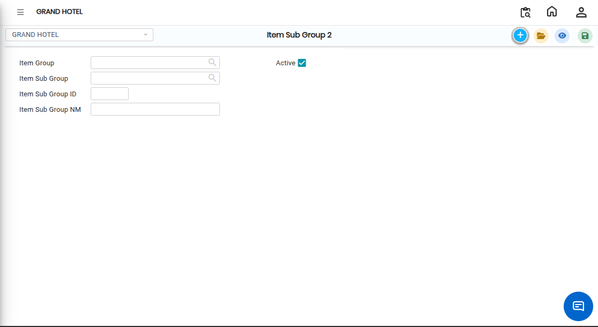

# Item Sub Group 2

**Item Sub Group 2** is a further level of item classification used to divide items under an **Item Group** and **Item Sub Group 1**. It helps in creating a more detailed hierarchy for better organization, reporting, and item selection in the system.

### Steps to Create Item Sub Group 2

1\. Navigate to the **Point of Sale** module and select **Masters1**.

* Click on **Item Sub Group 2.**
* The Item Sub Group 2 screen will appear.

<figure><figcaption></figcaption></figure>

2.Click on the **New** button to start creating a new Item Sub Group 2.

3.Choose the **Item Group Name** from the available list.

* This links the entry to the main item category.

4\. Select the relevant **Item Sub Group 1** under which Item Sub Group 2 will be created

* This ensures proper hierarchy and classification.

5\. After selecting all required details, click on the **Save** button.

* The system will successfully create and store the Item Sub Group 2.

<figure><figcaption></figcaption></figure>
