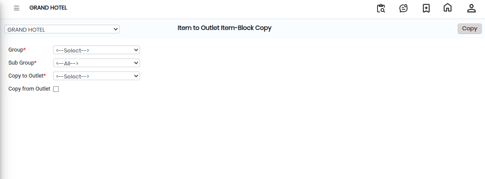

# Item to Outlet Item-Block Copy

The **Item to Outlet Item-Block Copy** feature is used to copy item settings from one outlet to another based on the selected **Group** and **Sub Group**. This helps save time by avoiding manual item creation for multiple outlets.

### Steps to Create Item to Outlet Item-Block Copy

1.Navigate to the **Point of Sale** module and select **Masters1**.

* Click on **Item to Outlet Item-Block Copy.**
* The Item to Outlet Item-Block Copy screen will appear.

<figure><figcaption></figcaption></figure>

2\. Click on the **New** button to begin the item copy process.

3\. Select the following details from the available options:

* **Group** – Select the required Item Group.
* **Sub Group** – Select the corresponding Item Sub Group.
* **Copy to Outlet** – Select the outlet where the items need to be copied.

These selections define which items will be copied and the destination outlet.

4\. After selecting all required details, click on the **Copy** button.

* The system will copy the selected items to the chosen outlet successfully.

<figure><figcaption></figcaption></figure>
