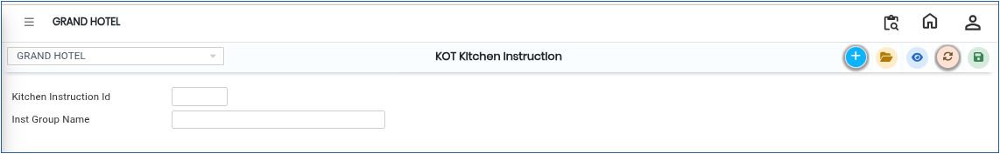
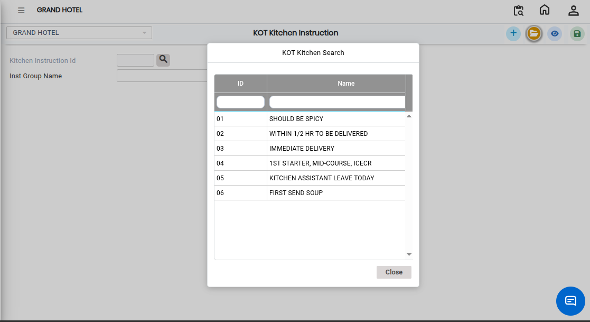

# KOT Kitchen Instruction

**KOT Kitchen Instruction** is a feature used to define and manage special instructions that are sent to the kitchen along with the Kitchen Order Ticket (KOT).

* These instructions help kitchen staff understand **customer preferences or preparation requirements** clearly.

## Steps to Create KOT Kitchen Instruction

Step 1: Navigate through the menu using the following path:

1. **Point of Sale module→ Masters1 → KOT → KOT Table**
2. The KOT Kitchen Instruction screen will open.

Step 2: On the screen:

1. Click the **New** button.
2. A new entry form will appear.

* This allows the user to add a new kitchen instruction.

<figure><figcaption></figcaption></figure>

Step 3: After opening the form,

1. Enter the **kitchen instruction text** that should be sent to the kitchen.
2. Select or enter the **product group name** to which the instruction belongs.

* This helps categorize instructions based on menu sections.

<figure><figcaption></figcaption></figure>

Step 4: After entering all details:

1. Verify the instruction and group name.
2. Click the **Save** button.

* The system will successfully store the kitchen instruction.
