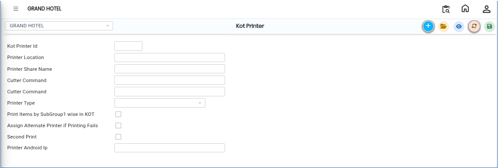
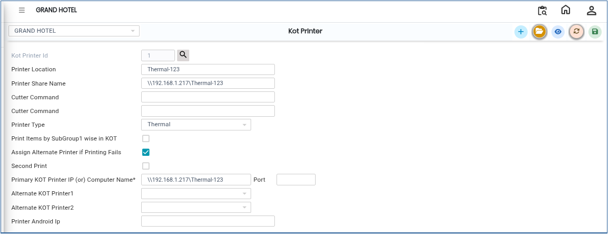

# KOT Printer

A **KOT Printer** prints kitchen order tickets.The KOT contains details such as table number, items ordered and their quantity.

## Steps to Create a KOT Printer

Step 1: Navigate through the menu using the following path:

1. **Point of Sale module→ Masters1 → KOT → KOT Table**
2. The KOT Printer screen will open.

Step 2: On the KOT Printer screen:

1. Click the **New** button.
2. A new entry screen will appear.

* This allows the user to configure a new printer for KOT printing.

<figure><figcaption></figcaption></figure>

Step 3: In the **Printer Location** field enter the location where the printer is installed.

* This helps the system identify which printer should receive the KOT.

Step 4: After entering the printer location:

1. Enter the **Printer Share Name** in the required field.
2. The printer share name should match the shared printer name configured in the system or network.

* This allows the software to connect and print to the correct network printer.

Step 5: The system also provides a **Second Print Option**.

This option is useful when:

* The primary printer is not working
* There is a printer connection issue
* A backup printer is required

To configure the backup printer:

1. Enter the second printer details.
2. Select or configure the alternate printer.

If the primary printer fails, the KOT will automatically print through the second printer.

<figure><figcaption></figcaption></figure>

Step 6: After entering all the required details:

1. Verify the information entered.
2. Click the **Save** button.

The system will successfully create the KOT Printer configuration.

<figure><figcaption></figcaption></figure>
