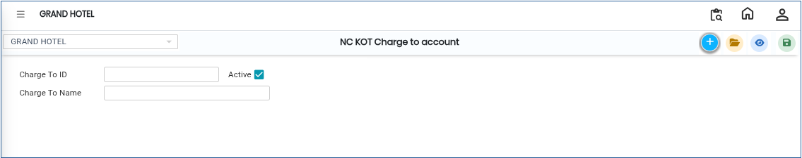

# NC KOT Charge To Accounts

The **NC KOT Charge to Account** screen is used to create and manage charge-to account details for NC KOT (Non-Chargeable Kitchen Order Ticket) transactions.\
Using this screen, users can define a Charge ID and Charge Name, which can be used for accounting and billing purposes.

## Steps to Open NC KOT Charge to Account

Step 1: Navigate to the **Point of Sale** module and select **Masters1**.

1. Click on **NC KOT Charge to account**.

* The NC KOT Charge to Account screen will open.

Step 2: In the NC KOT Charge to Account screen, click on the **New** button.

* A new entry form will appear to create a charge account.

<figure><figcaption></figcaption></figure>

Step 3: Enter Required Information

1. Enter the following details in the respective fields:
   * **Charge To ID**
   * **Charge To Name**

Ensure the details are entered correctly before saving.

Step 4: After entering all required information, click on the **Save** button.

* The NC KOT Charge to Account details will be successfully saved in the system.
