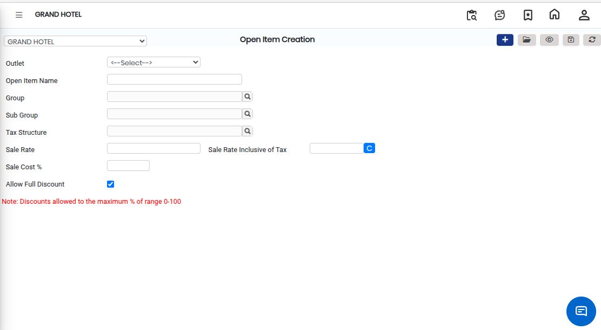

# Open Item

An **Open Item** is a master setup used to define items that are not fixed under a single predefined item structure. It allows the user to create items based on an **Outlet**, along with their **Group** and **Tax Structure**, so they can be used in transactions such as billing and sales.

### Steps to Create an Open Item

1.Navigate to the **Point of Sale** module and select **Masters1**.

* Click on **Open Item.**
* The Open Item screen will appear.

<figure><figcaption></figcaption></figure>

2\. Click on the **New** button to start creating a new Open Item.

3\. Choose the **Outlet Name** from the available list.

* This ensures the item is mapped to the correct outlet/location.

4\. Select the appropriate **Group** for the item.

* Select the applicable **Tax Structure.**
* These settings define how the item will be categorized and taxed during transaction.

5\. After entering all required details, click on the **Save** button.

* The system will successfully create and store the Open Item.

<figure><figcaption></figcaption></figure>
