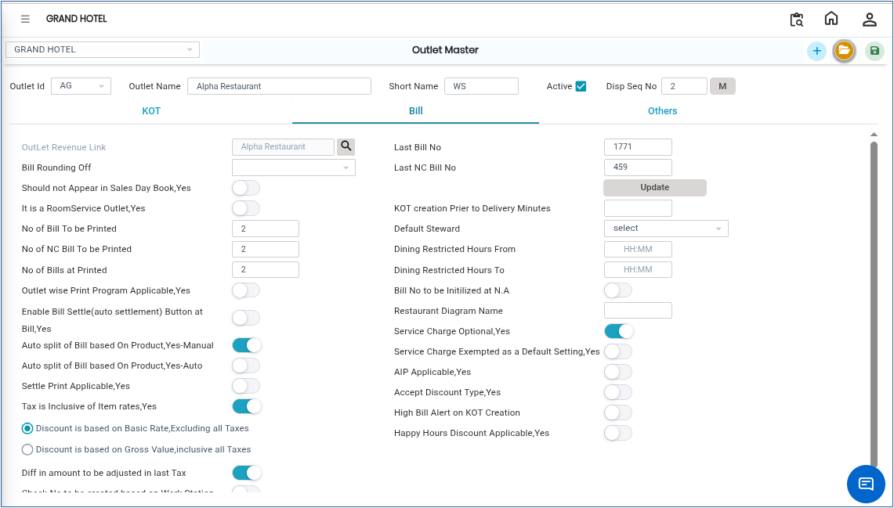

# Outlet Master

The **Outlet Master** screen is used to create and manage outlet details in the system. Using this screen, you can enter outlet information such as Outlet ID, Outlet Name, KOT settings, billing settings, and other required configurations.

## Steps to Open Outlet Master

Step 1: Navigate to the **Point of Sale** module and select **Masters1**.

1. Click on **Outlet Master**.

* The **Outlet Master** screen will open.

Step 2: In the Outlet Master screen, click on the **New** button.

* A new entry form will appear, allowing you to create a new outlet.

Step 3: Enter Basic Outlet Information

1. Click on the **Outlet ID** field.
2. Enter the required details:
   * **Outlet ID**
   * **Outlet Name**
   * **Short Name**

Make sure all details are entered correctly before proceeding.

Step 4: Click on the **KOT** tab.

1. Select the required options based on your requirements.

* The KOT section is used to configure Kitchen Order Ticket settings for the outlet.
* Choose the appropriate settings carefully to ensure proper kitchen and order processing.

Step 5: Set Billing Options

1. Click on the **Bill** tab.
2. Select the required billing options as per your requirement.

* Ensure the correct billing settings are selected for smooth billing operations.

Step 6: Set Additional Options.

1. Click on the **Others** tab.
2. Select the required additional settings based on your operational needs.

* The Others section contains miscellaneous outlet configurations and additional preferences.

<figure><figcaption></figcaption></figure>

Step 7: Save the Record.

1. After entering all required details and configurations, click on the **Save** button.

The outlet will be successfully created and stored in the system.
