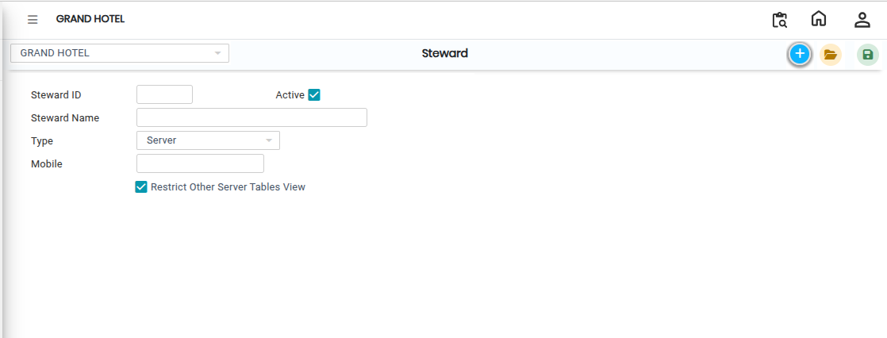

# Steward

The **Steward** screen is used to create and manage steward details in the system.\
Using this screen, users can enter steward information such as Steward ID, Steward Name, and Steward Type.

## Steps to Open Steward

Step 1: Navigate to the **Point of Sale** module and select **Masters1**.

1. Click on **Steward**.

* The **Steward** screen will open.

Step 2: In the Steward screen, click on the **New** button.

* A new entry form will appear, allowing you to create a new steward record.

<figure><figcaption></figcaption></figure>

Step 3: Fill Steward Information:

1. Enter the following details in the respective fields:
   * **Steward ID**
   * **Steward Name**

* Ensure the entered information is correct before proceeding to the next step.

Step 4: After entering the steward details, select the required **Type** from the available options.

* The Type field is used to categorize the steward based on operational requirements.

Step 5: After completing all required fields, click on the **Save** button.

* The steward details will be successfully saved in the system.

<figure><figcaption></figcaption></figure>
