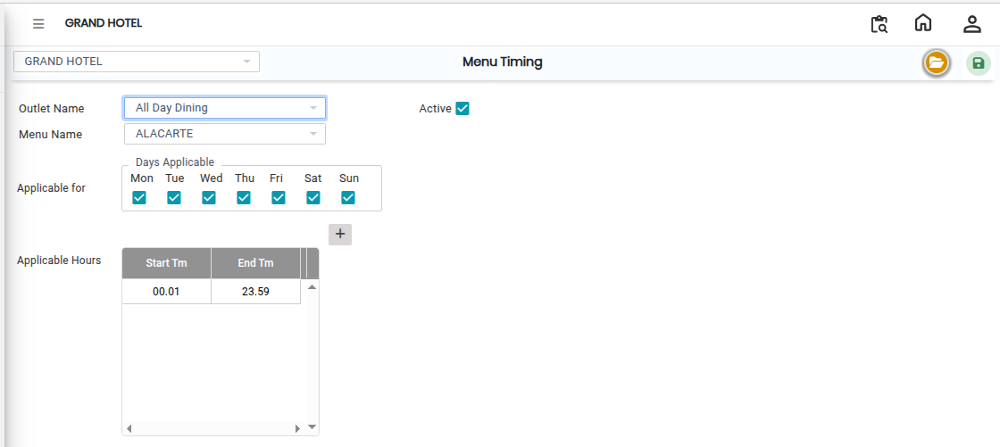
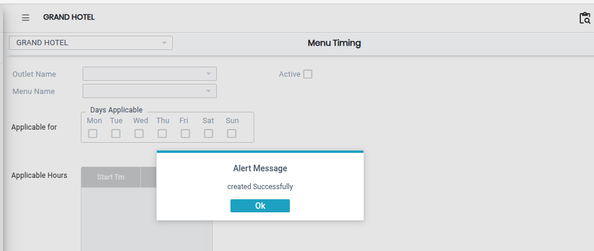

# Menu Timing

The **Menu Timing** feature in the E Menu module is used to define the availability timing of menus for specific outlets. It helps control when a particular menu should be displayed and accessed during business hours.

### Steps to Create and View Menu Timing

Step 1: Navigate to the **Point of Sale** module.

1. Go to **Master2 > E Menu > Menu Timing**.

* The Menu Timing screen will appear.

Step 2: Click on the **Open** button to proceed.

Step 3: Click on the **Outlet** field and select the required outlet from the list provided.

* Ensure the correct outlet is selected before proceeding.

Step 4: Select the required **Menu Name** from the available list.

* Enter or select the required **Start Time** and **End Time** for the menu.
* Make sure the timing entered is accurate according to the outlet’s operating schedule.

<figure><figcaption></figcaption></figure>

Step 5: After entering all the required details, click on the **Save** button to successfully save the Menu Timing configuration.

<figure><figcaption></figcaption></figure>
