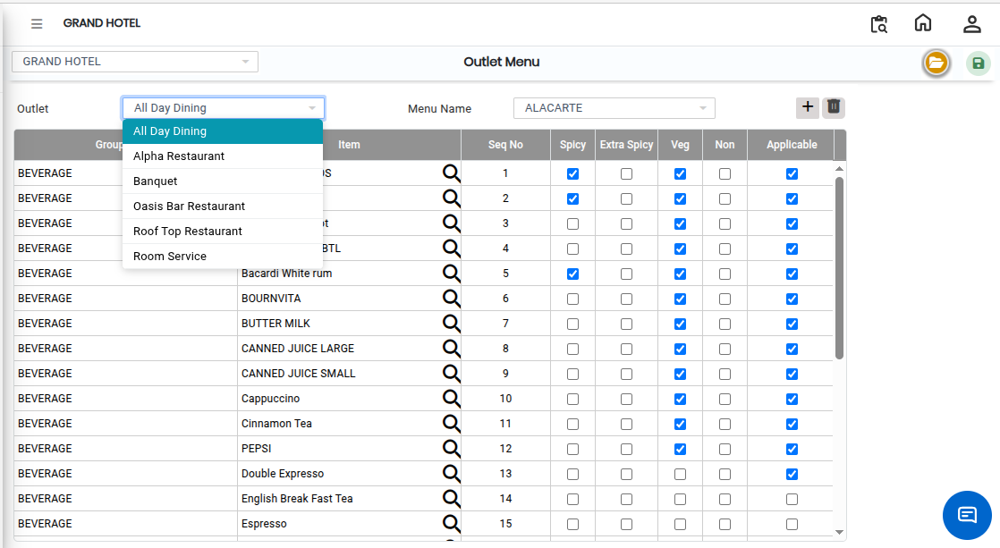
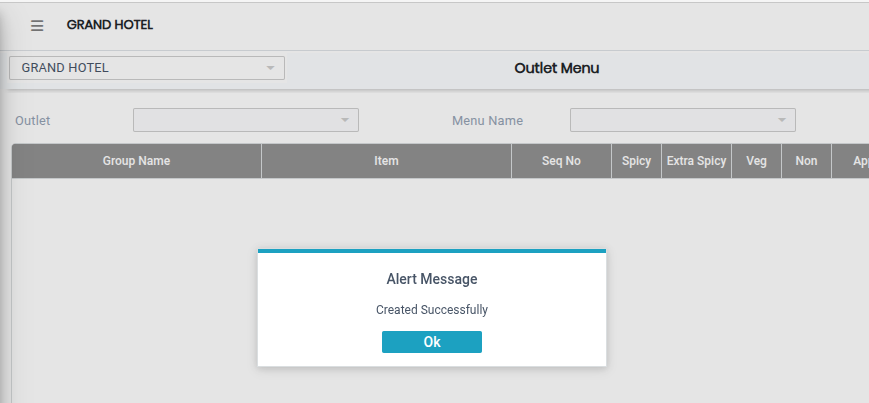

# Outlet Menu

The **Outlet Menu** feature in the E Menu module is used to assign menu items to a specific outlet and menu. It helps organize and manage the items that will be available for customers in each outlet.

### Steps to Create and View Outlet Menu

Step 1: Navigate to the **Point of Sale** module.

1. Go to **Master2 > E Menu > Outlet Menu**.

* The Outlet Menu screen will appear.

Step 2: Click on the **Open** button to proceed.

Step 3: Choose the required **Outlet** from the outlet list.

* Select the appropriate **Menu Name**.
* Click on the **Add** button to add items to the selected menu.

Step 4: Select the required items from the item list displayed on the screen.

* Multiple items can be selected based on the menu requirement.
* Ensure the correct items are selected for the chosen outlet and menu.

<figure><figcaption></figcaption></figure>

Step 5: Once all required items are selected, click on the **Save** button to successfully save the Outlet Menu details.

<figure><figcaption></figcaption></figure>
