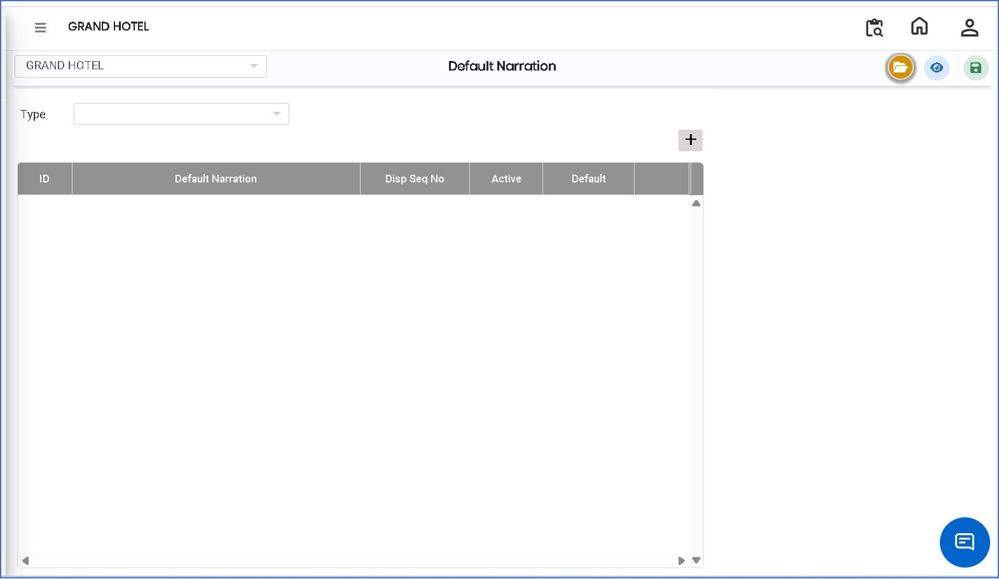
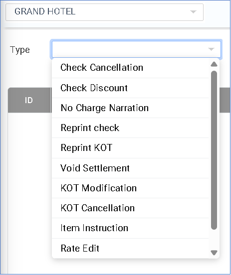
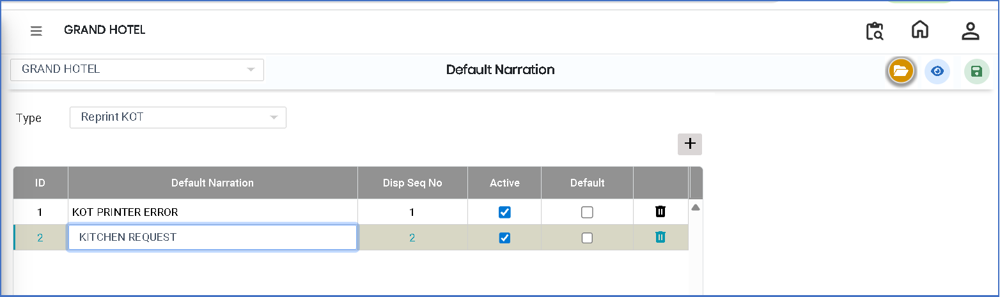

# Default Narration

The **Default Narration** feature is used to define standard or pre-set narration texts in the system. These narrations are automatically used in transactions based on the selected type, helping to maintain consistency and reduce manual entry errors.

### Steps to Create and View Default Narration

Step 1: Navigate to the **Point of Sale** module.

1. Go to **Master3 > Outlet - Default Narration**.

* The Default Narration screen will appear.

<figure><figcaption></figcaption></figure>

Step 2: Click on the **Open** button to proceed.

Step 3: Click on the **Type** field and select the required type from the available list.

* Ensure the correct type is selected before proceeding.

<figure><figcaption></figcaption></figure>

Step 4: Click on the **Add** button to create a new narration entry.

* Enter the required **Default Narration** text in the provided field.
* Ensure the narration is clear, meaningful, and correctly formatted.

<figure><figcaption></figcaption></figure>

Step 5: Save the Default Narration

* After entering all required details, click on the **Save** button to successfully store the Default Narration.
