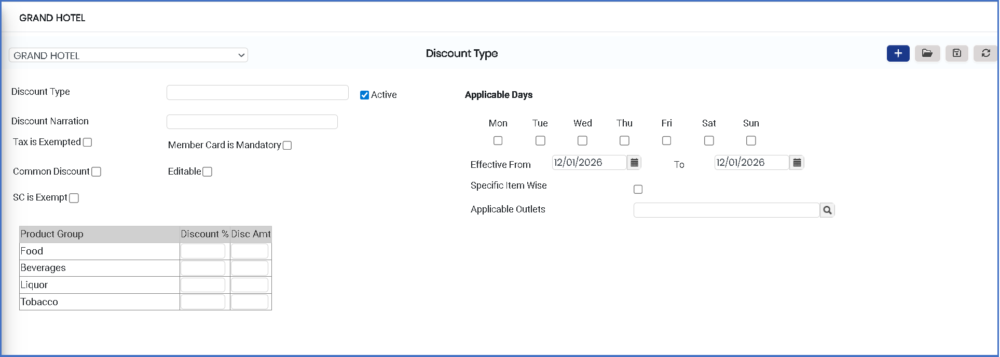
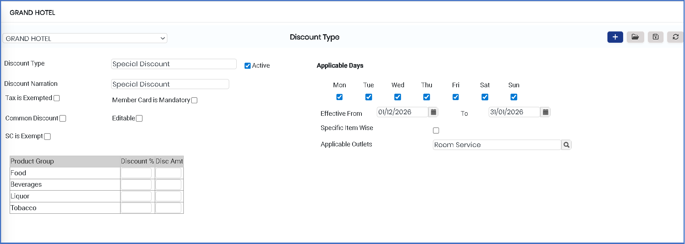

# Discount Type

The **Discount Type** feature is used to define different types of discounts in the system. It helps categorize discounts based on their purpose, usage, and applicable conditions such as specific days or promotional rules.

### Steps to Create and View Discount Type

Step 1: Navigate to the **Point of Sale** module.

1. Go to **Master3 > Outlet - Discount Type**.

* The Discount Type screen will appear.

<figure><figcaption></figcaption></figure>

Step 2: Click on the **New** button to create a new discount type.

Step 3: Enter Discount Details.

Enter the required information in the available fields:

* **Discount Type** – Enter the name of the discount type.
* **Narration** – Provide a short description or explanation of the discount type.
* **Applicable Days** – Select the days on which the discount will be applicable.

Ensure all details are entered correctly before proceeding.

<figure><figcaption></figcaption></figure>

Step 4: Save the Discount Type.

* After entering all required details, click on the **Save** button to successfully create and store the Discount Type.
