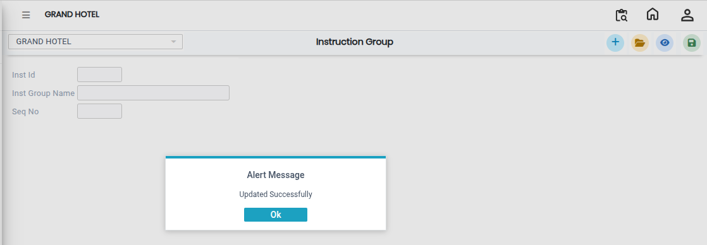

# Instruction Group

The **Instruction Group** feature is used to create and manage groups of instructions in the system. It helps organize multiple instructions under a single group for better classification and easy management.

### Steps to Create and View Instruction Group

Step 1: Navigate to the **Point of Sale** module.

1. Go to **Master3 > Instruction Group**.

The Instruction Group screen will appear.

Step 2: Click on the **Add** button to create a new instruction group.

Step 3: Enter the required **Instruction Group Name** in the provided field.

* Ensure the group name is clear and meaningful for easy identification.

Step 4: Save the Instruction Group

* After entering the Instruction Group Name, click on the **Save** button to successfully create and store the group.

<figure><figcaption></figcaption></figure>
