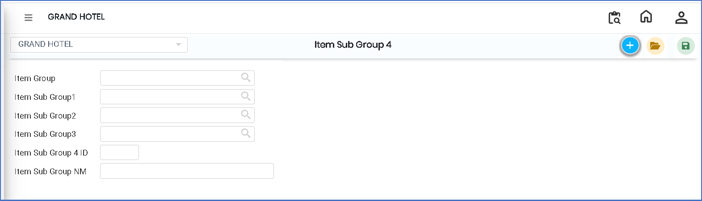
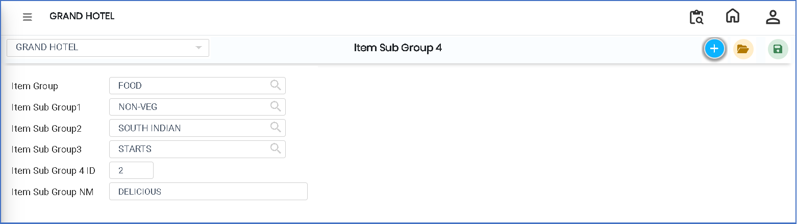

# Item Sub Group 4

The **Item Sub Group 4** feature is used to create the fourth level of item categorization in the system. It provides deeper classification of items under Item Group, Item Sub Group 1, Item Sub Group 2, and Item Sub Group 3. This helps in better organization and accurate mapping of items in the system.

### Steps to Create and View Item Sub Group 4

Step 1: Navigate to the **Point of Sale** module.

1. Go to **Master3 > Item Sub Group 4**.

* The Item Sub Group 4 screen will appear.

Step 2: Click on the **Add** button to create a new entry.

<figure><figcaption></figcaption></figure>

Step 3: Select Item Group and Sub Groups.

Click on the **Item Group search icon**.

* Select the required **Item Group**.
* Choose the related sub groups:
  * Item Sub Group 1
  * Item Sub Group 2
  * Item Sub Group 3

Ensure the correct hierarchy is selected before proceeding.

<figure><figcaption></figcaption></figure>

Step 4: Save Item Sub Group 4

* After selecting all required details, click on the **Save** button to successfully create the Item Sub Group 4.
