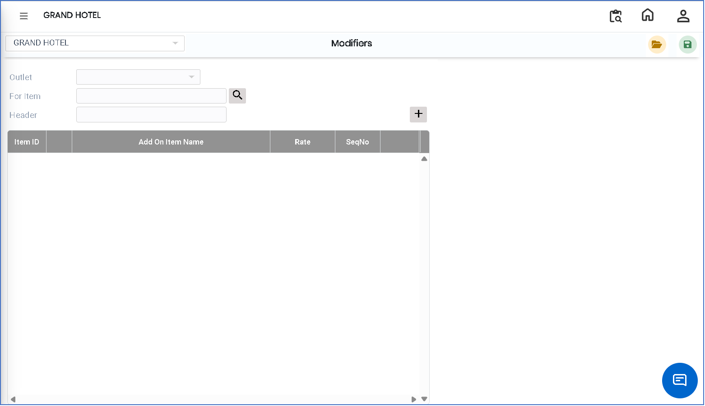
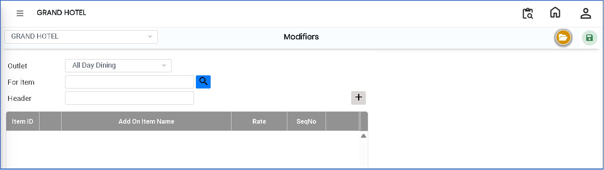
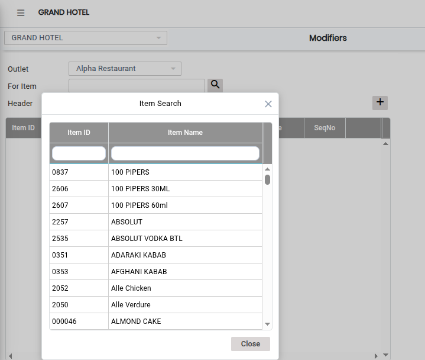
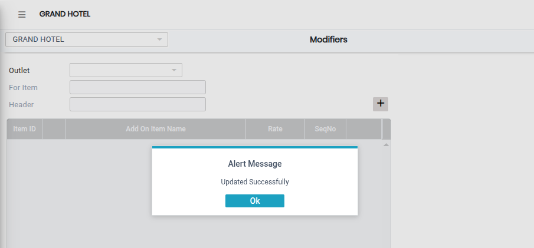

# Modifiers

The **Modifiers** feature is used to define additional options or customizations for menu items in the system. These modifiers allow customers to modify items based on their preference, such as extra ingredients, spice level, or add-ons.

### Steps to Create and View Modifiers

Step 1: Navigate to the **Point of Sale** module.

1. Go to **Master3 > Modifiers**.

* The Modifiers screen will appear.

Step 2: Click on the **Open** button to proceed.

<figure><figcaption></figcaption></figure>

Step 3: Select the required **Outlet Name** from the available list.

* Click on the **Search icon** in the item selection field.
* Choose the required items for which modifiers need to be applied.

<figure><figcaption></figcaption></figure>

Step 4: Click on the **Add** button.

* Select the required items from the list shown.
* Assign or map the selected items as modifiers for the chosen menu items.

Ensure all selections are correct before proceeding.

<figure><figcaption></figcaption></figure>

Step 5: After configuring the required modifiers, click on the **Save** button to successfully store the Modifiers setup.

<figure><figcaption></figcaption></figure>
