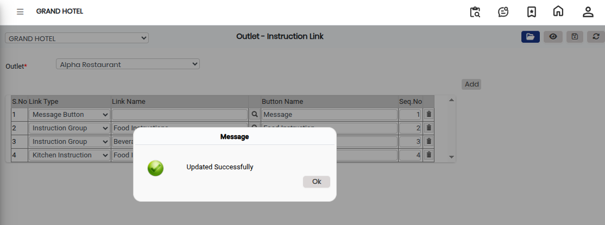

# Outlet - Instruction Link

The **Outlet - Instruction Link** feature is used to link instructions to a specific outlet. These instructions can be used for operational guidance, order processing, or outlet-specific requirements within the system.

### Steps to Open and Configure Outlet - Instruction Link

Step 1: Navigate to the **Point of Sale** module.

1. Go to **Master3 > Outlet - Instruction Link**.

* The Outlet - Instruction Link screen will appear.

Step 2: Click on the **Open** button to proceed.

Step 3: Select the required **Outlet Name** from the list provided.

* Ensure the correct outlet is selected before proceeding.

Step 4: Click on the **Add** button to create a new instruction link.

Step 5: Enter the required details in the provided fields:

* **Link Type** – Select or enter the type of instruction link.
* **Link Name** – Enter the instruction link name.

Review the entered details carefully before saving.

Step 6: Click on the **Save** button to successfully save the Outlet - Instruction Link details.

<figure><figcaption></figcaption></figure>
