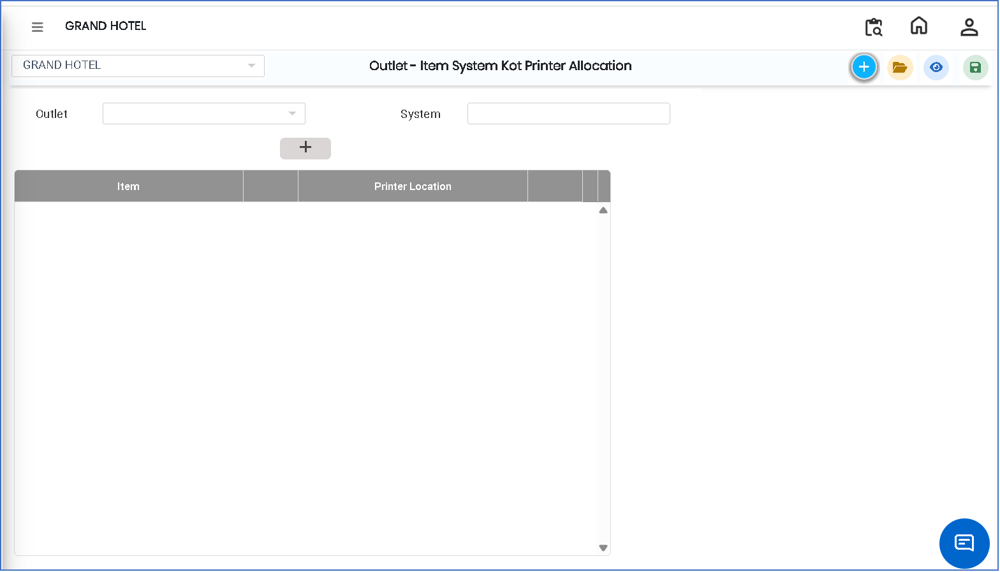
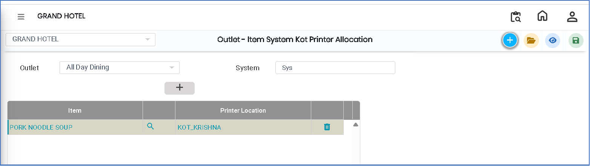

# Outlet – Item System KOT Printer Allocation

The **Outlet – Item System KOT Printer Allocation** feature is used to assign items to specific system-based KOT (Kitchen Order Ticket) printers for an outlet. This ensures that selected items are printed on the correct KOT printer based on system configuration, helping streamline kitchen operations and order processing.

### Steps to Create and View Outlet – Item System KOT Printer Allocation

Step 1: Navigate to the **Point of Sale** module.

1. Go to **Master3 > Outlet - Item System KOT Printer Allocation**.

* The Outlet – Item System KOT Printer Allocation screen will appear.

<figure><figcaption></figcaption></figure>

Step 2: Click on the **New** button to create a new allocation entry.

Step 3: Select the required **Outlet Name** and **System**

* After selecting both, click on the **Add** button.

Step 4: Choose the required **items** from the list displayed.

* Ensure that the correct items are selected for the selected system and outlet.
* Items will be mapped to the selected KOT printer setup.

<figure><figcaption></figcaption></figure>

Step 5: Save the Allocation

* After selecting all required details, click on the **Save** button to successfully store the configuration.
