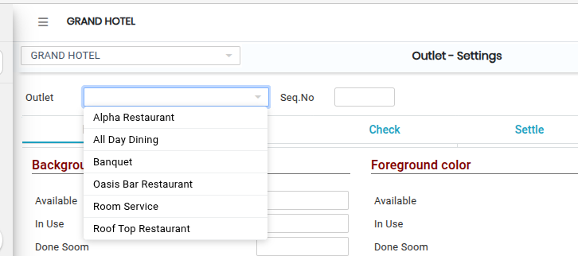
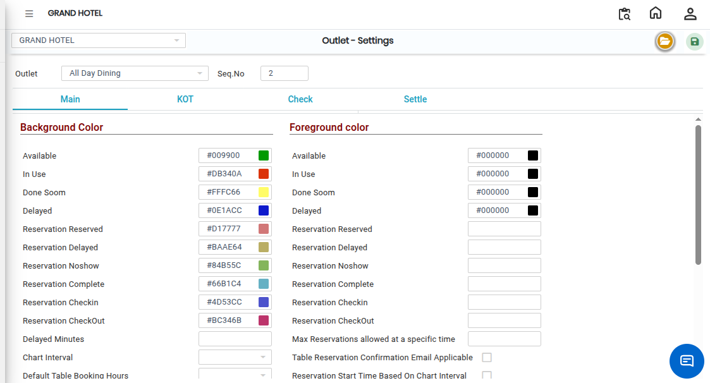
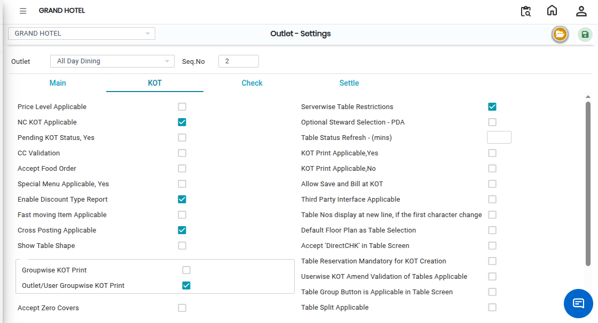
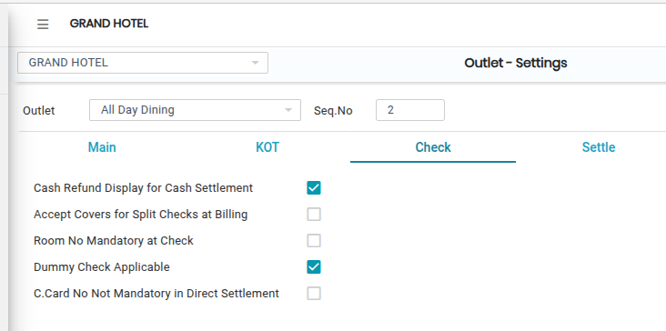
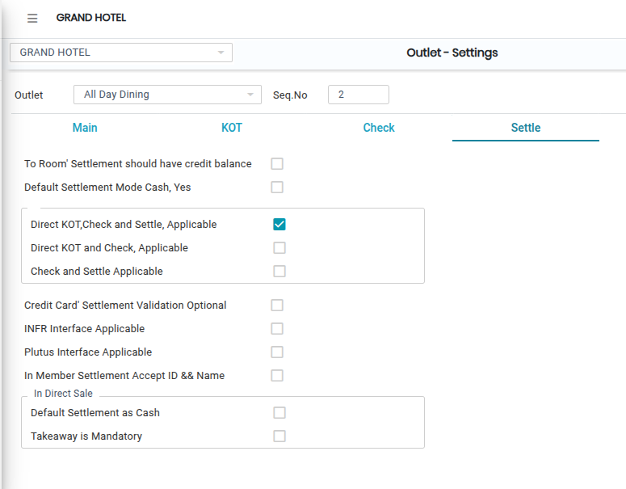
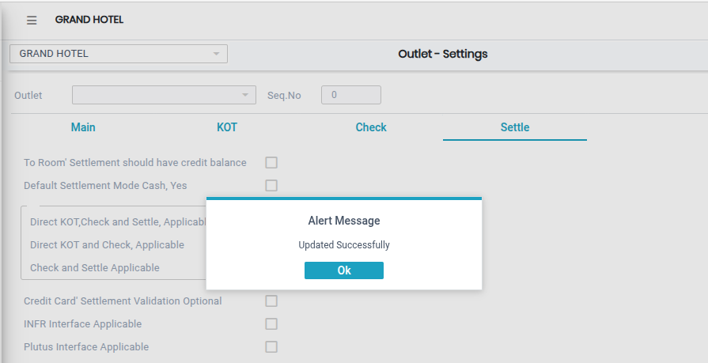

# Outlet Settings

The **Outlet – Settings** feature is used to configure and manage operational settings for a specific outlet. It allows users to customize settings related to Main operations, KOT (Kitchen Order Ticket), Check, and Settle functions.

### Steps to Open and Configure Outlet Settings

Step 1: Navigate to the **Point of Sale** module.

1. Go to **Master3 > Outlet - Settings**.

* The Outlet Settings screen will appear.

Step 2: Click on the **Open** button to proceed.

Step 3: Select the required **Outlet** from the outlet list.

<figure><figcaption></figcaption></figure>

Step 4: Click on the **Main** tab or button to view and configure the main outlet settings.

<figure><figcaption></figcaption></figure>

Step 5: Click on the **KOT** tab.

* The KOT settings screen will appear.
* Make the required configuration changes related to Kitchen Order Ticket operations.

<figure><figcaption></figcaption></figure>

Step 6: Click on the **Check** tab.

* The Check settings screen will appear.
* Update the required settings related to billing and check management.

<figure><figcaption></figcaption></figure>

Step 7: Click on the **Settle** tab.

* The Settle settings screen will appear.
* Configure the required settlement and payment-related settings.

<figure><figcaption></figcaption></figure>

Step 8: Save the Settings

* After making all the necessary changes, click on the **Save** button to save the Outlet Settings successfully.

<figure><figcaption></figcaption></figure>
