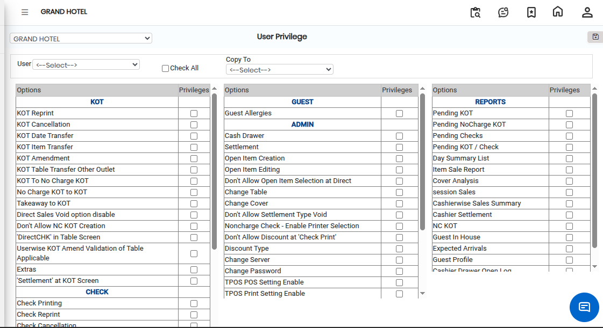
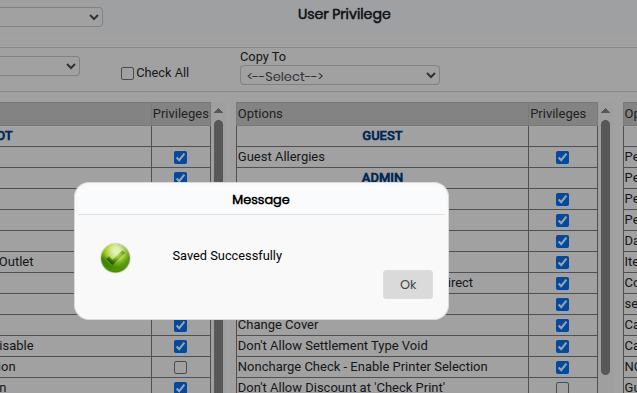

# User Privilege

The **User Privilege** feature is used to assign permissions and access rights to users in the system. It helps control which modules, functions, and operations a user can access based on their role and responsibilities.

### Steps to Open and Configure User Privileges

Step 1: Navigate to the **Point of Sale** module.

1. Go to **Master3 > User Privilege**.

* The User Privilege screen will appear.

Step 2: Click on the **Open** button to proceed.

Step 3: Select the required user to whom privileges need to be assigned.

* Ensure the correct user is selected before assigning permissions.

Step 4: Select the required **User Privileges** from the available options.

* Enable or disable permissions based on the user’s role and access requirements.
* Review the selected privileges carefully before saving.

<figure><figcaption></figcaption></figure>

Step 5: Save the User Privileges

* After selecting the required privileges, click on the **Save** button to successfully save the user permissions.

<figure><figcaption></figcaption></figure>
