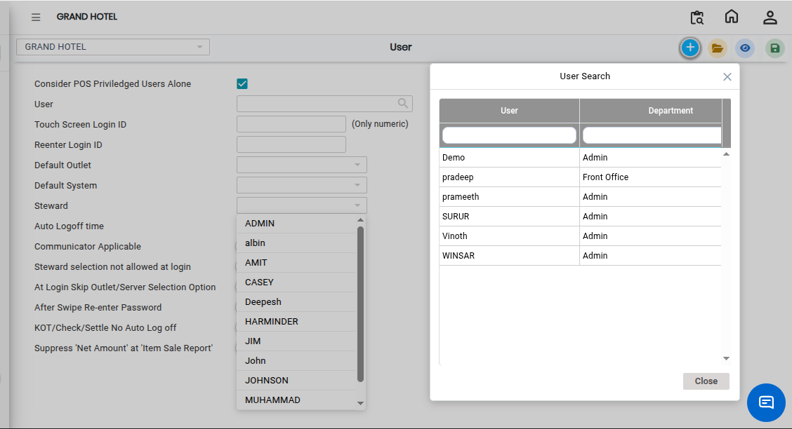
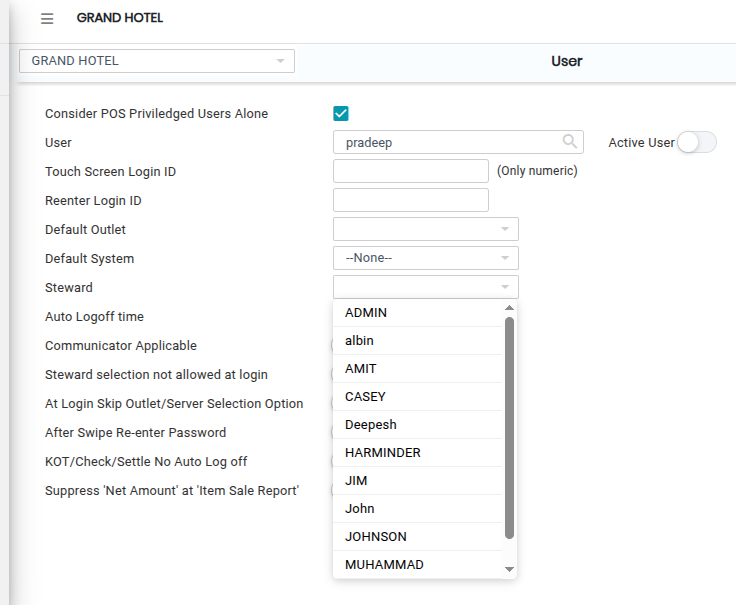
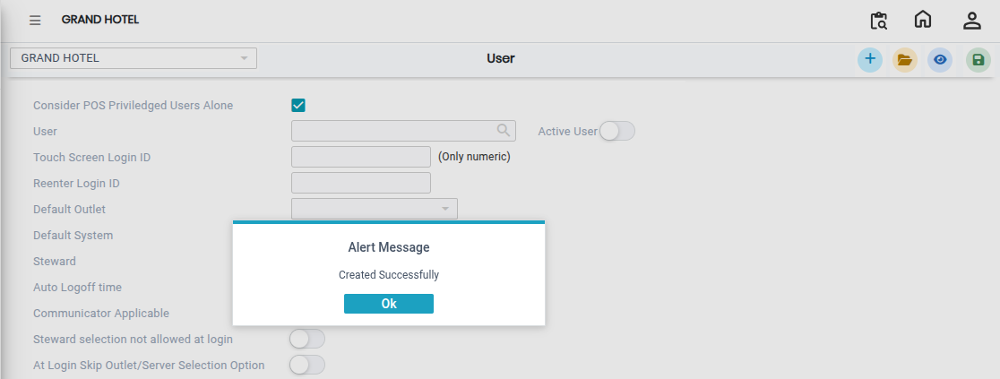

# User

The **User** feature in the system is used to create and manage user accounts. It allows administrators to assign users, such as stewards, to the system with the required access and permissions.

### Steps to Create and View a User

Step 1: Navigate to the **Point of Sale** module.

1. Go to **Master3 > User.**

* The User screen will appear.

Step 2: Click on the **New** button to create a new user account.

Step 3: Click on the **Search icon** in the User section.

* A search window will appear.
* Search and select the required user details from the list provided.

<figure><figcaption></figcaption></figure>

Step 4: Click on the **Steward** field and choose the required steward from the available list.

* Ensure the correct steward is selected before proceeding.

<figure><figcaption></figcaption></figure>

Step 5: After entering and verifying all required information, click on the **Save** button to successfully create the user account.

<figure><figcaption></figcaption></figure>
