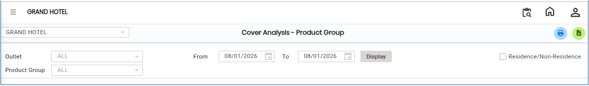
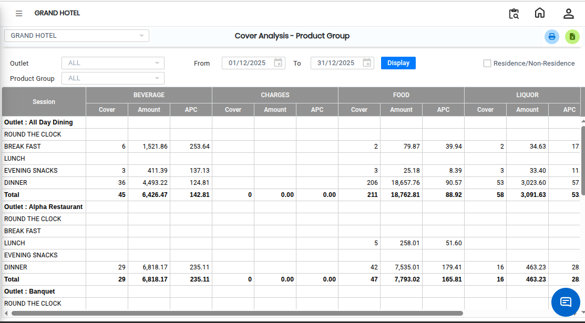

# Cover Analysis- Product Group

The **Cover Analysis – Product Group Report** provides detailed information about sales covers based on product groups. This report helps users analyze sales performance by grouping products and reviewing the number of covers or packs sold for each product group.

## Steps to Open the Cover Analysis – Product Group Report

Step 1: Navigate to the **Point of Sale** module and click the **Analysis** menu.

1. Select **Cover Analysis – Product Group**

* The **Cover Analysis – Product Group** screen will be displayed.

Step 2: Choose the Required Filters

<figure><figcaption></figcaption></figure>

Step 3: After selecting the required options, click on the **Display** button.

* The report will be generated and displayed on the screen.

<figure><figcaption></figcaption></figure>

If you want to save or download the report in Excel format:

1. Click on the **Excel Export Icon** available on the report screen.
