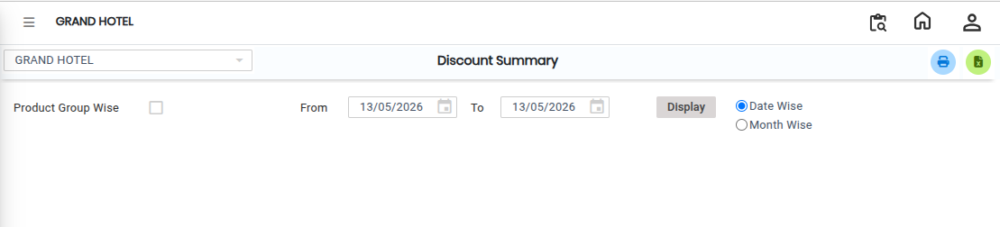
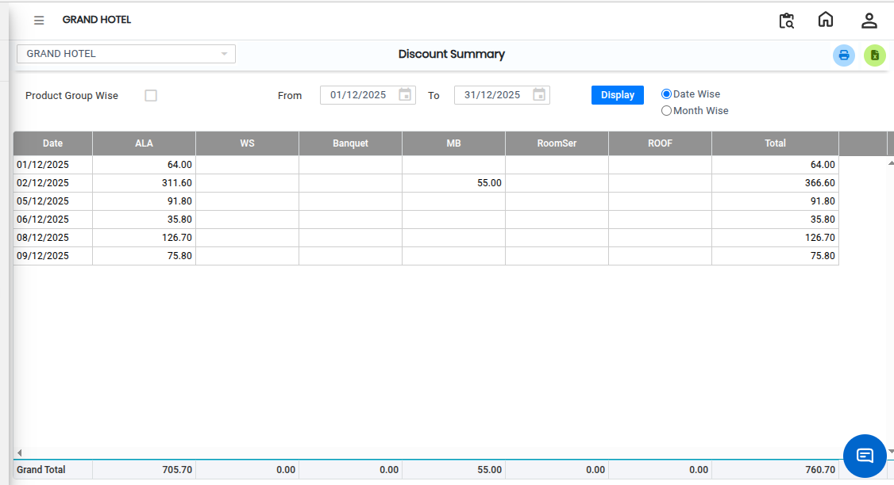

# Discount Summary

The **Discount Summary** report is used to view and analyze discount-related details in the system. It provides a summary of discounts applied across transactions and helps users review discount usage effectively.

Step 1: Navigate to the **Point of Sale** module and click the **Analysis** menu.

1. Select **Discount Summary**

* The **Discount Summary** screen will be displayed.

Step 2: Apply **Filters**, based on the required report output.

<figure><figcaption></figcaption></figure>

Step 3: After applying the required filters, click the **Display** button.

* The system will generate the Discount Summary report.

<figure><figcaption></figcaption></figure>

If the user wants to convert the report into Excel format:

1. Click the **Excel Export** button/icon available on the screen.
