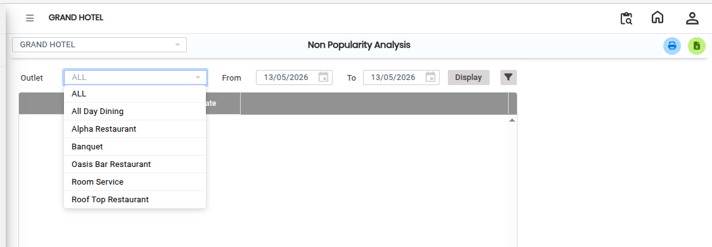
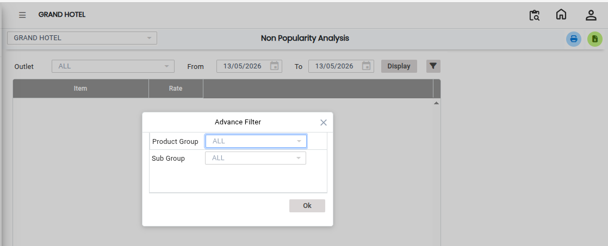
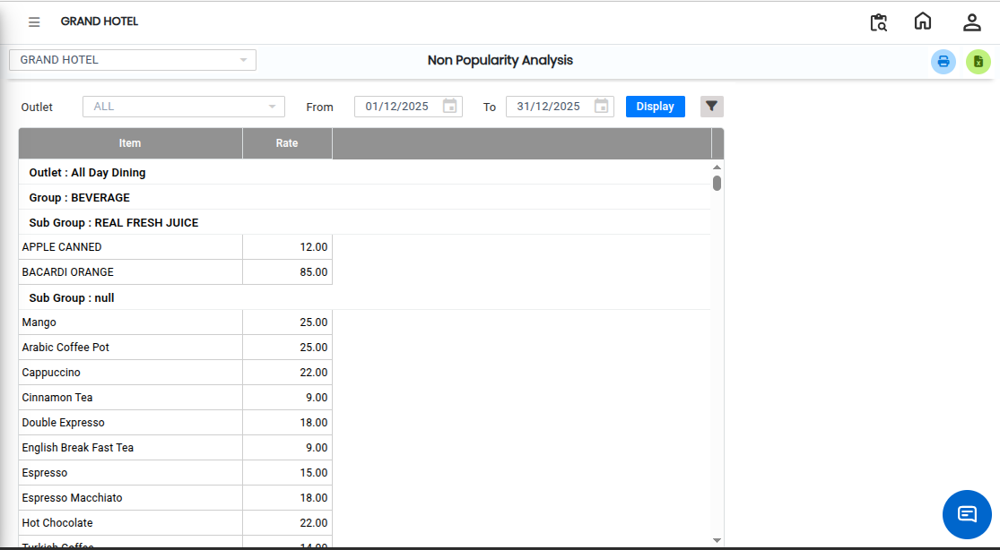

# Non -Popularity Analysis

The **Non Popularity Analysis Report** provides summarized information about menu items that are less popular or have lower sales performance during a selected period. This report helps users identify low-performing items and analyze areas that may require improvement.

## Steps to View the Non Popularity Analysis Report

Step 1: Navigate to the **Point of Sale** module and click the **Analysis** menu.

1. Select **Non Popularity Analysis.**

* The Non Popularity Analysis screen will be displayed.

Step 2: Select the required **Outlet** from the available options.

1. Choose the required **From Date** and **To Date** to filter the report data.

<figure><figcaption></figcaption></figure>

Step 3: Choose the required **Advance Filter** options to customize the report.

* Additional filter options are available to refine the report results.

<figure><figcaption></figcaption></figure>

Step 4: After selecting the outlet, date range and Filter, click on the **Display** button.

* The report data will be generated and displayed on the screen.

<figure><figcaption></figcaption></figure>

To print the report directly:

1. Click on the **Print Icon** available on the report screen.

To convert and save the report in Excel format:

1. Click on the **Excel Export Icon** available on the report screen.
