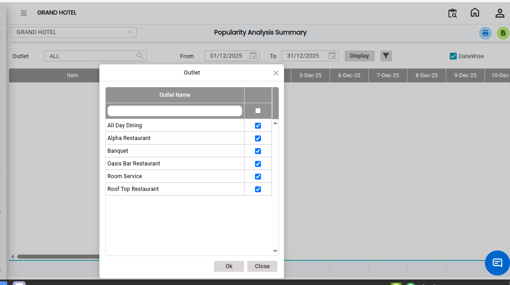
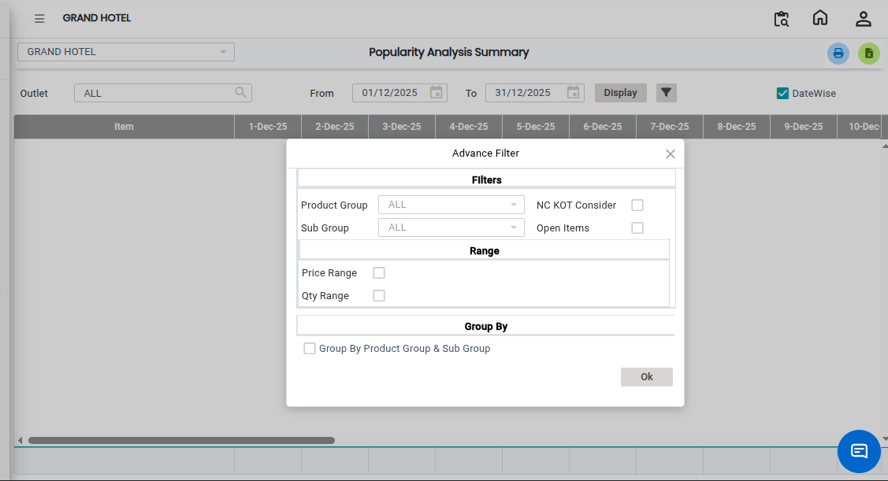
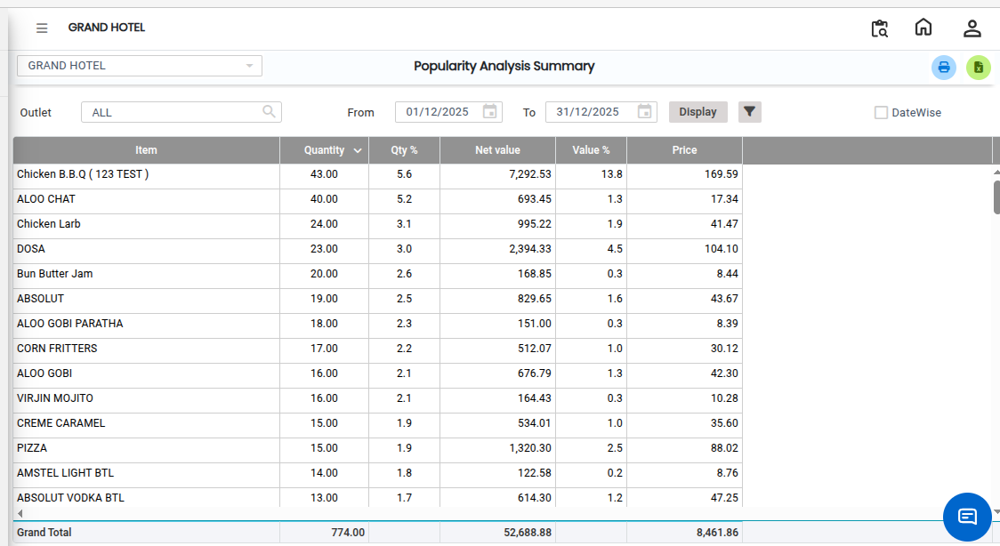

# Popularity Analysis-Summary

The **Popularity Analysis – Summary Report** provides summarized information from the Popularity Analysis Report. This report helps users quickly review the performance and popularity of menu items without viewing detailed transaction-level data.

## Steps to View the Popularity Analysis – Summary Report

Step 1: Navigate to the **Point of Sale** module and click the **Analysis** menu.

1. Select **Popularity Analysis – Summary Report.**

* The **Popularity Analysis – Summary Report** screen will be displayed.

Step 2: Select the required **Outlet** from the available list.

1. Choose the required **From Date** and **To Date** for filtering the report data.

<figure><figcaption></figcaption></figure>

Step 3: Choose the required **Advance Filter** options to customize the report.

* Additional filter options are available to refine the report results.

<figure><figcaption></figcaption></figure>

Step 4: After selecting the required outlet and date range, click on the **Display** button.

* The report data will be generated and displayed on the screen.

<figure><figcaption></figcaption></figure>
