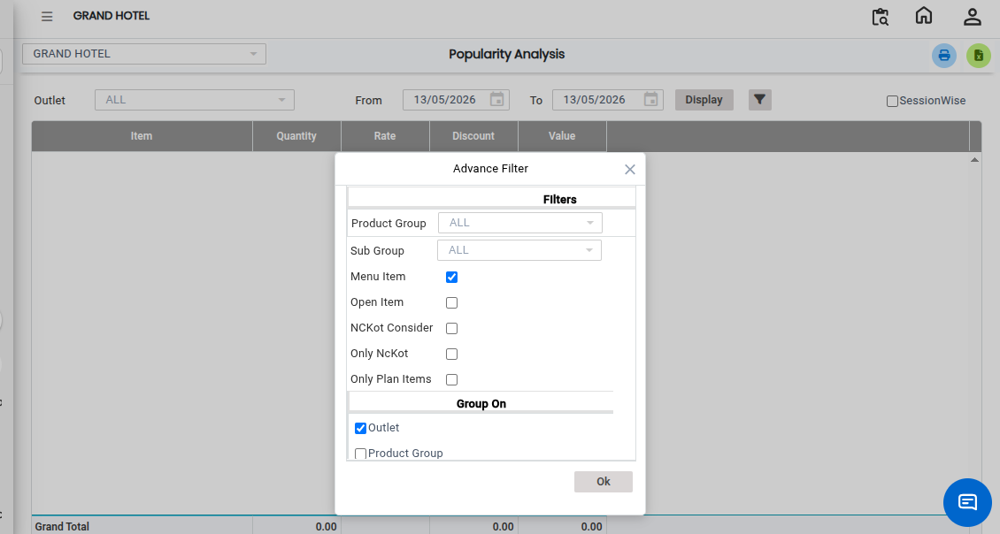
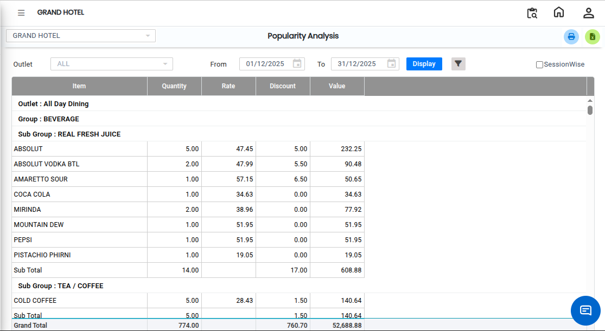

# Popularity Analysis

The **Popularity Analysis Report** helps users analyze the popularity and profitability of menu items within the restaurant. This report provides valuable insights into item performance by identifying which menu items are selling the most and generating the highest profit.

## Steps to Open the Popularity Analysis Report

Step 1: Navigate to the **Point of Sale** module and click the **Analysis** menu.

1. Select **Popularity Analysis**

* The **Popularity Analysis** screen will be displayed.

Step 2: Choose the required **Advance Filter** options for the report.

* The filter options help users generate reports based on specific business requirements.

<figure><figcaption></figcaption></figure>

Step 3: After selecting the required filters and options, click on the **Display** button.

* The Popularity Analysis Report will appear on the screen.

<figure><figcaption></figcaption></figure>
