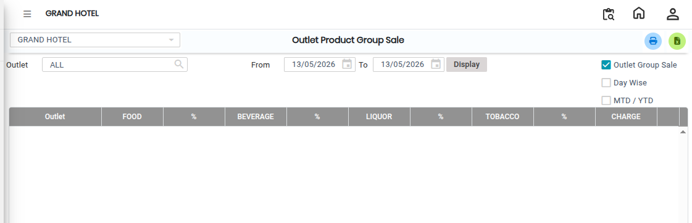
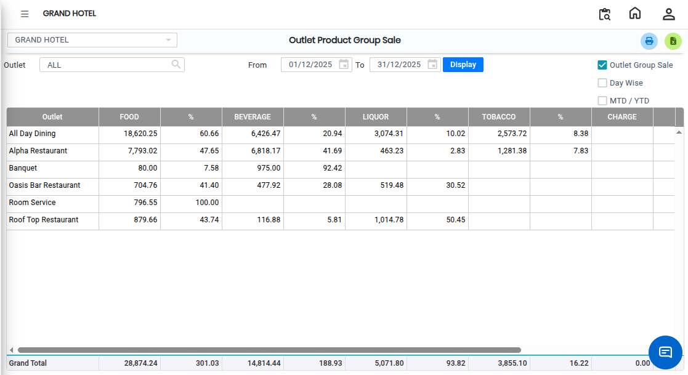

# Outlet Group Product Sale

The **Outlet Product Group Sale** report is used to view and analyze sales performance based on product groups at each outlet. This report helps users understand how different product groups are performing across various outlets.

## Steps to Open Outlet Product Group Sale

Step Navigate to the **Point of Sale** module and click the **Analysis** menu.

1. Select **Outlet Product Group Sale.**

Step 2: On the **Outlet Product Group Sale** screen, filter options will be available.

1. Set the required filter values based on the report requirement.

<figure><figcaption></figcaption></figure>

Step 3: After applying the filters, click the **Display** button.

* The **Outlet Product Group Sale** report will be displayed on the screen.

<figure><figcaption></figcaption></figure>

If the user wants to convert the report into Excel format:

1. Click the **Excel Export** button/icon available on the screen.
