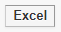

# Outlet Sales Analysis

**Outlet Sales Analysis**

What is **Outlet Sales Analysis ?**

The **Outlet Sales Analysis** provides an outlet wise and day wise overall sales report. This provides collection break up, product group wise.

Steps to open **Outlet Sales Analysis**

1. Go to **Analysis > Outlet Sales Analysis**
2. Choose the additional option that you want printed in this report, screen shown below.

.png>)

3\. By clicking display it will generate the report shown below.

**Note** : If the user would like to convert the report to excel click 
