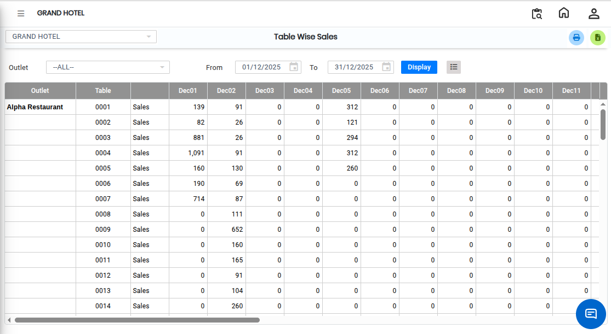

# Table Wise Sales

The **Table Wise Sales** feature allows users to view sales details for each table along with the total collection amount. Follow the steps below to access and view the Table Wise Sales report.

## Steps to View Table Wise Sales

Step 1: Navigate to the **Point of Sale** module and select **Queries** menu.

1. Click on **Table Wise Sales**.

* After clicking **Table Wise Sales**, the Table Wise Sales screen will appear.

<figure><figcaption></figcaption></figure>

Step 2: The Table Wise Sales screen will display the available sales details.

1. Users can review sales information related to different tables.

* This screen helps users analyse sales activity table by table.

Step 3: After clicking the Display button, the system will show the sales report.

<figure><figcaption></figcaption></figure>

Step 4: View Total Collections.

1. The report will display the sales details for each table.
2. Users can also view the **Total Collection Amount** from the displayed report.

* This helps users monitor overall sales performance and table-wise collections.
