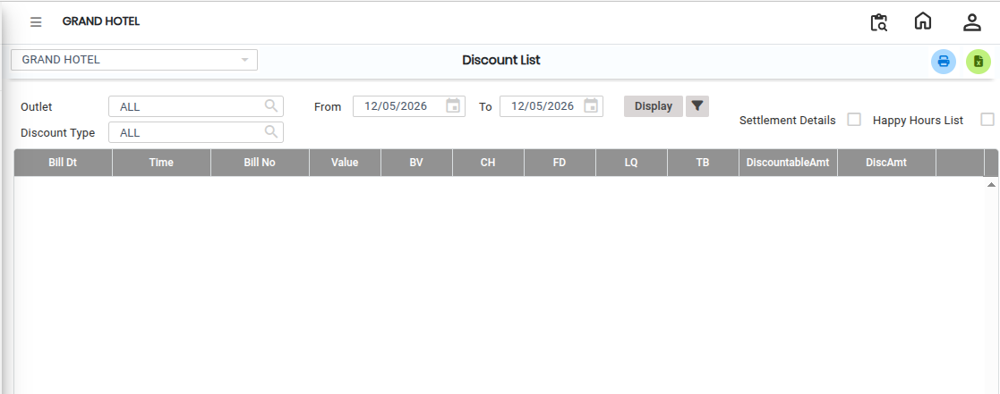
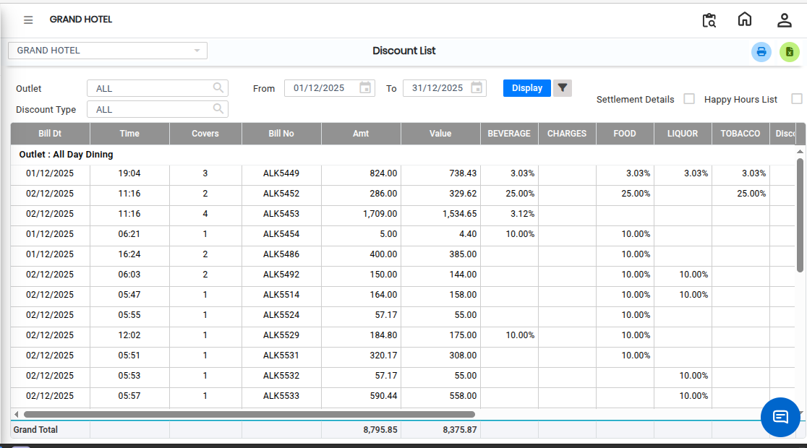

# Discount Bill

The **Discount List Report** is used to view details of discounts applied to bills and transactions. This report helps users track discount information and analyze discount usage across outlets and bills.

## Steps to Open the Discount List Report

Step 1: Navigate to the **Point of Sale** module and click the **Reports** menu.

1. Select **Discount List Report**.

* The Discount List Report screen will appear.

<figure><figcaption></figcaption></figure>

Step 2: Select Required Filters

1. Outlet-wise Filter

* If you want to view discount details for a specific outlet, select the required **Outlet** from the outlet filter option.

2. Detailed Bill Information

* If you want to view detailed information for a particular bill, select the **Details** checkbox as shown on the screen.

This option allows users to view complete discount details for individual bills.

Step 3: After selecting all the required fields and filters, click on the **Display** button.

* The Discount List Report will load and display the selected discount details on the screen.

<figure><figcaption></figcaption></figure>

* If you want to export the report to Excel format, click on the **Excel Export Icon** available on the screen.
