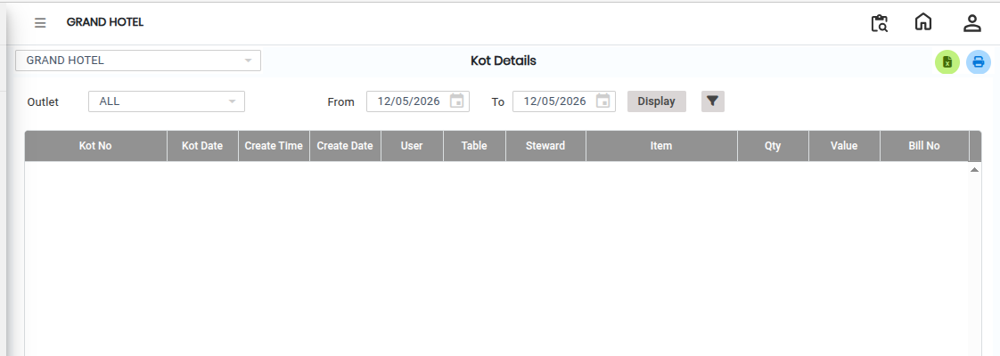

# KOT Details

Step 1: Navigate to the **Point of Sale** module and click the **Reports** menu.

1. Select **KOT Details**.

* The KOT Details screen will appear.

<figure><figcaption></figcaption></figure>

Step 2: Click on the **Advanced Filter** option.

* The Advanced Filter screen will appear.

Step 3: Select the required filter options based on your report requirements.

* Click on the **Display** button.
* The KOT Details Report will be displayed on the screen.

<figure><figcaption></figcaption></figure>
