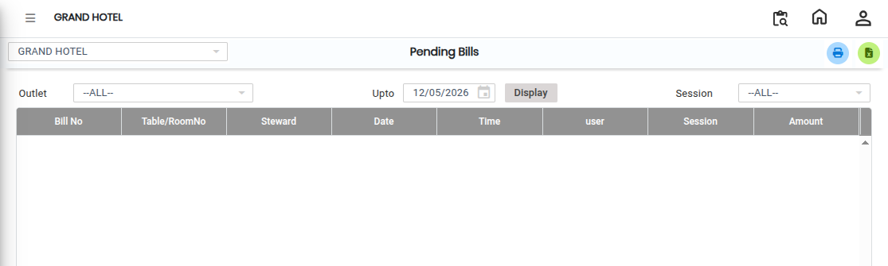

# Pending Bill

The **Pending Bills Report** is used to view all bills that are not yet settled. This report helps users track unpaid or pending bills efficiently.

* Users can also filter the report outlet-wise to view pending bills for a specific outlet.

## Steps to View the Pending Bills Report

Step 1: Navigate to the **Point of Sale** module and click the **Reports** menu.

1. Select **Pending Bills**.

* The Pending Bills report screen will appear.

<figure><figcaption></figcaption></figure>

Step 2: If the user wants to view pending bills for a specific outlet, select the required **Outlet** from the outlet selection option.

* Selecting an outlet helps generate outlet-wise pending bill reports.

Step 3: After selecting the required outlet, click on the **Display** button.

1. The Pending Bills report will appear on the screen.

* The report will display all unsettled bills based on the selected criteria.

<figure><figcaption></figcaption></figure>
