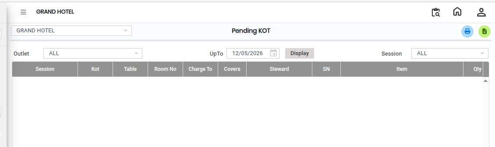
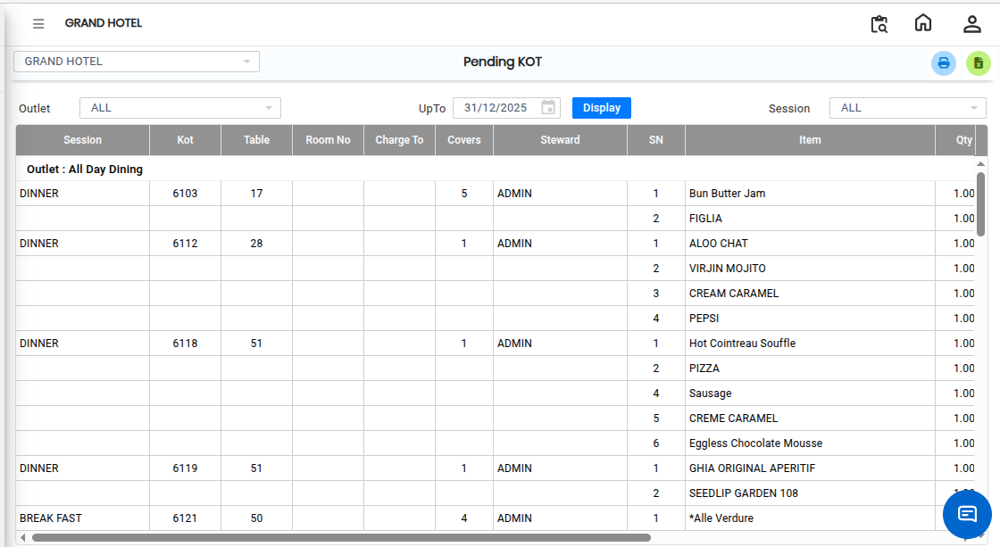

# Pending KOT

The **Pending KOT (Kitchen Order Ticket)** report displays all KOTs that have been created but are not yet billed. Each KOT is shown along with its corresponding food items that have been punched into the system.

## Steps to View the Pending KOT Report

Step 1: Navigate to the **Point of Sale** module and click the **Reports** menu.

1. Select **Pending KOT**.

* The Pending KOT report screen will appear.

<figure><figcaption></figcaption></figure>

Step 2: Before viewing the report, select the required details:

1. Choose the **Date**.
2. Select the **Outlet**.
3. Select the **Session** if required.

* These filters help generate the report based on specific requirements.

Step 3: After selecting the required filters, click on the **Display** button.

1. The system will display all pending KOTs.

<figure><figcaption></figcaption></figure>

Step 4: To view whether serve instructions have been added to the KOT, tick the **Serve Instructions** checkbox.

1. The report will display the related instructions along with the KOT details.

* This helps kitchen and service staff identify special instructions for orders.

Step 5: To print the Pending KOT report directly, click on the **Print** button.

1. The report will be sent to the configured printer.

Step 6: To convert and save the report in Excel format, click on the **Excel Export** button.
