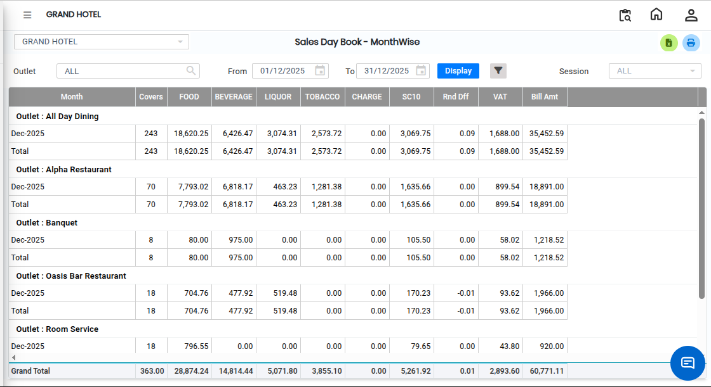

# Sales Day Book Month Wise

The **Sales Day Book Month Wise Report** is used to view sales details on a monthly basis. This report provides a day-wise summary of sales transactions for the selected month.

## Steps to View the Sales Day Book Month Wise Report

Step 1: Navigate to the **Point of Sale** module and click the **Reports** menu.

1. Select **Sales Day Book Month Wise**.

* The Sales Day Book Month Wise screen will open.

<figure><figcaption></figcaption></figure>

Step 2: Choose the required **Outlet** for which the report needs to be generated.

* Ensure the correct outlet is selected before proceeding.

Step 3: Use the **Advanced Filter** option to sort and filter the report based on your requirements.

1. Select the necessary filter criteria.

* The Advanced Filter option helps users generate more accurate and customised reports.

Step 4: After selecting the required options and filters, click on the **Display** button.

1. The Sales Day Book Month Wise Report will be generated and displayed on the screen.

<figure><figcaption></figcaption></figure>

If you want to export the report to Excel:

1. Click on the **Excel Export Icon** available on the report screen.
2. The report will be downloaded in Excel format.
