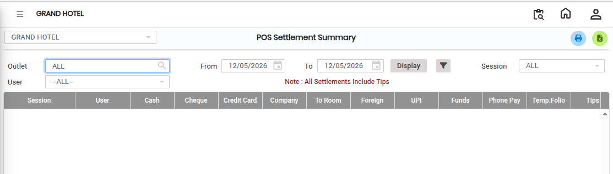
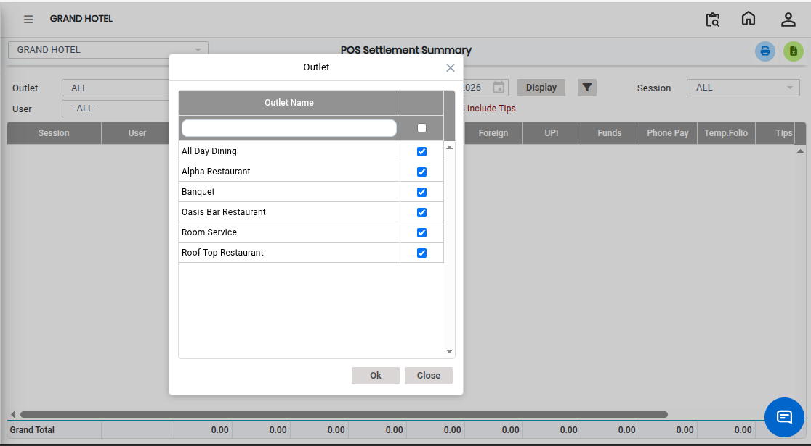
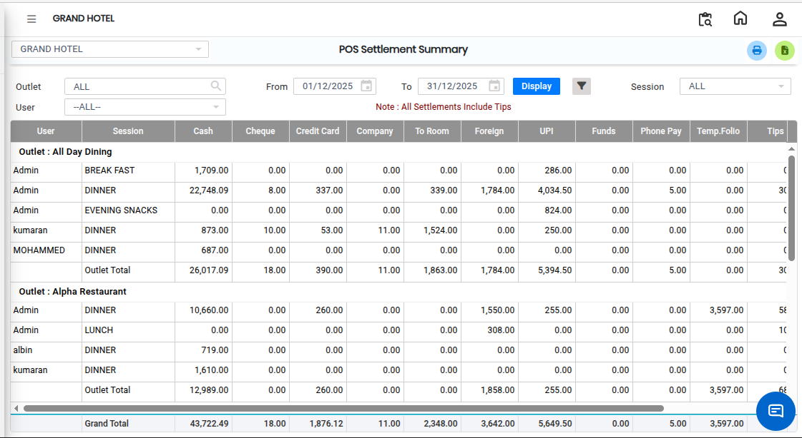

# Settlement POS Summary

The **Settlement (POS) Summary Report** provides a summary of all settled transactions processed through the POS system. This report helps users analyze settlement information in a summarized format, including outlet-wise and user-wise settlement details.

## Steps to Open the Settlement (POS) Summary Report

Step 1: Navigate to the **Point of Sale** module and click the **Reports** menu.

1. Select **Settlement (POS) Summary**.

* The Settlement (POS) Summary Report screen will appear.

<figure><figcaption></figcaption></figure>

Step 2: Select the required **Outlet** for which the settlement summary report needs to be generated.

* This option allows users to generate outlet-specific settlement summaries.

<figure><figcaption></figcaption></figure>

Step 3: Click on the **Advanced Filter** option.

* The Advanced Filter screen will appear, allowing users to apply additional sorting and filtering options for more detailed report analysis.

Step 4: After selecting all the required filters, click on the **Display** button.

* The report will load and display the different types of settlements along with the summary details.

<figure><figcaption></figcaption></figure>

* If you want to export the report to Excel format, click on the **Excel Export Icon** available on the screen.
