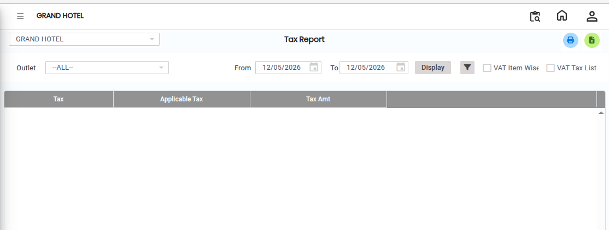
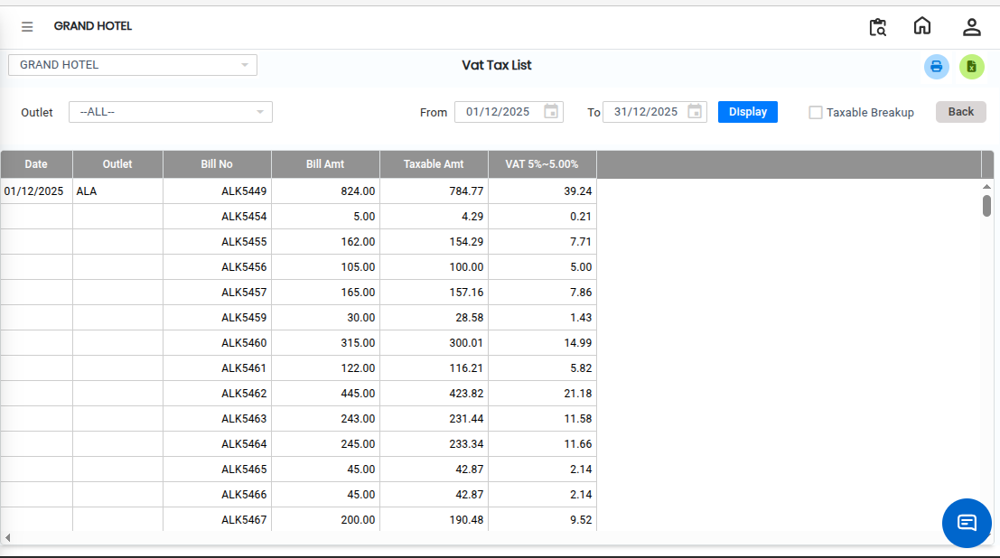
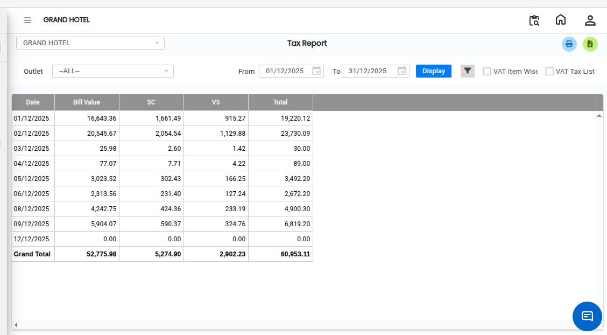

# Tax Report

The **Tax Report** is a detailed financial report used to calculate and display the tax payable based on sales transactions. It provides a clear summary of taxable income and related GST details.

* This report is useful for tax analysis and statutory reporting.

## Steps to View Tax Report

Step 1: Navigate to the **Point of Sale** module and click the **Reports** menu.

1. Select **Tax Report**.

* The Tax Report screen will open.

<figure><figcaption></figcaption></figure>

Step 2: Choose the required **additional options** that you want to include in the report.

* These options help customize the report based on user requirements.

Step 3: Select the **GST Tax List** option.

* This will generate a **bill-wise tax report** showing detailed GST information.

<figure><figcaption></figcaption></figure>

Step 4: Use the available sorting options to arrange the data as needed.

* Sorting helps in organizing the report for better analysis.

Step 5: After selecting all required options, click on the **Display** button.

* The system will generate and display the Tax Report on the screen.

<figure><figcaption></figcaption></figure>
