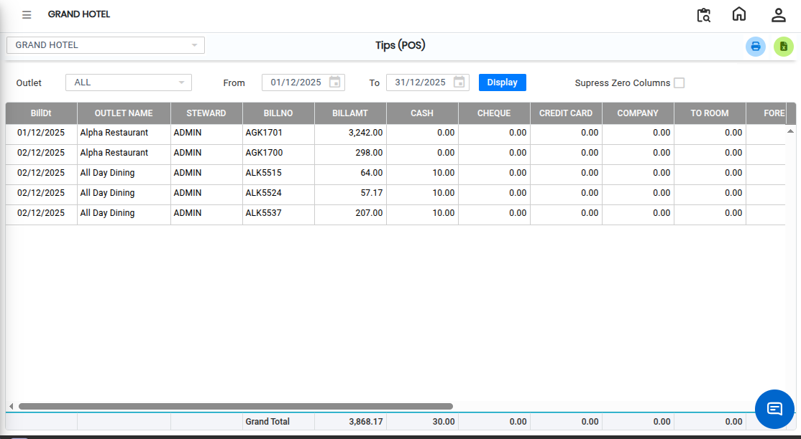

# Tips POS

The **Tips (POS) Report** is used to view tip-related details recorded in the Point of Sale (POS) system. This report helps users track the tips received during billing transactions for a selected outlet.

## Steps to View Tips (POS) Report

Step 1: Navigate to the **Point of Sale** module and click the **Reports** menu.

1. Select **Tips (POS)**.

* The Tips (POS) report screen will open.

<figure><figcaption></figcaption></figure>

Step 2: Choose the required **Outlet** for which you want to generate the report.

1. Ensure the correct outlet is selected before proceeding.

Step 3: After selecting the required options, click on the **Display** button.

* The system will process the request and generate the report.
* The Tips (POS) report will then be displayed on the screen, showing all relevant tip details for the selected outlet.

<figure><figcaption></figcaption></figure>
