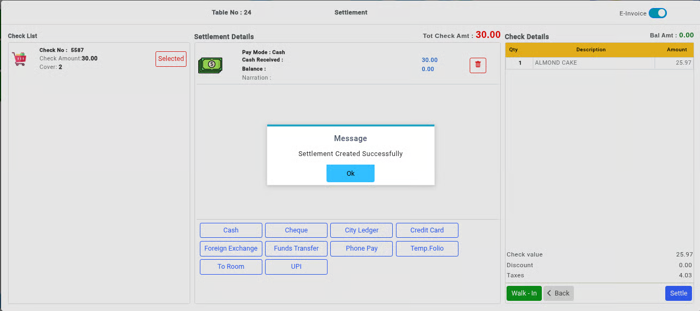

# KOT (Kitchen Order Ticket)

**KOT** stands for **Kitchen Order Ticket**. It is one of the most important procedures in the restaurant billing process. A KOT contains the list of food and beverage items ordered by the guest. Once the KOT is created, it is sent directly to the kitchen for preparation and is also used for billing purposes.

* The KOT can be modified before the final bill is generated, based on the guest’s requests or order changes.

## Steps to Create a KOT

Step 1: Go to the **Transactions** menu.

1. Click on **KOT**.

* This will redirect you to the KOT login screen.

<figure><figcaption></figcaption></figure>

Step 2: On the login screen:

1. Select the preferred **Outlet**.
2. Select the **Table Server** or waiter.
3. Click **Login** to continue.

* This will open the table selection screen.

Step 3: From the displayed list of tables, select the required **Table Number**.

1. The selected table will open for order entry.

<figure><figcaption></figcaption></figure>

Step 4: Enter the number of **covers** (number of guests seated at the table).

1. Confirm the entry to proceed.

<figure><figcaption></figcaption></figure>

Step 5: Add Food Items to the KOT.

1. The order entry window allows you to add the food and beverage items ordered by the guest.

<figure><figcaption></figcaption></figure>

Step 6: Menu Navigation. The menu is organized into:

* **Group**
* **Sub-Group**
* **Items**

Example:

* Chinese → Non-Veg → Chicken Fried Rice

This categorization helps in quickly locating menu items.

<figure><figcaption></figcaption></figure>

Step 6: Select the required quantity from the **Quantity Column**.

1. Then select the food item.

**Important Notes:**

* Always select the quantity first and then the item.
* If the item is selected first, the system automatically assigns the default quantity as 1.

<figure><figcaption></figcaption></figure>

**Functional Buttons and Their Usage**

* The following buttons and options are available while creating a KOT.

Step 7: The **MESSAGE** button.png>) is used to add special instructions for a specific item (Examples: Less Oil, No Onion, With Ice Cubes, Extra Cheese).

* These instructions are sent directly to the kitchen.

<figure><figcaption></figcaption></figure>

Step 8: The **INSTRUCTION** button .png>)is used to add predefined instructions available in the system (Examples: Medium Spicy, Sharing 1/2, No Sugar).

* This helps maintain consistency in order preparation.

<figure><figcaption></figcaption></figure>

Step 9: The **BEVERAGE INSTRUCTION** option .png>)is used to add serving instructions for beverages (Examples: Serve Chilled, Without Ice, Serve Later).

<figure><figcaption></figcaption></figure>

Step 10: The **PACK** button is used to select package or combo options available for the item.

* This is mainly used for Combo meals, Meal packages and Special offers.

<figure><figcaption></figcaption></figure>

Step 11: The **DIRECT** buttonallows you to directly search and select menu items without navigating through groups and sub-groups.

* This option helps save time during busy restaurant operations.

<figure><figcaption></figcaption></figure>

Step 12:The **OPEN +** button is used to create an open item with a custom sales rate.

<figure><figcaption></figcaption></figure>

Step 13:The **REPEAT** button is used to repeat previously selected items in the KOT.

* This helps quickly duplicate orders without selecting the items again.

<figure><figcaption></figcaption></figure>

Step 14: The **FREE** button is used to mark an item as complimentary or free of charge (Example: Complimentary Dessert, Free Soft Drink).

* The selected item will not be charged in the bill.

<figure><figcaption></figcaption></figure>

Step 15: After adding all food and beverage items, click on **Save KOT**.

* The KOT will be sent to the kitchen for preparation.

<figure><figcaption></figcaption></figure>

Step 16: The **CHECK & SETTLE** button is used to directly move the KOT to settlement mode without printing the KOT bill.

<figure><figcaption></figcaption></figure>

Step 17: If the **E-Invoice** option is enabled:

* The KOT bill can be sent directly to the guest through **WhatsApp**.
* This provides a quick and paperless billing experience.

Step 18: After selecting the settlement mode, click on the **Settle** button.

1. The billing process will be completed successfully.

<figure><figcaption></figcaption></figure>
