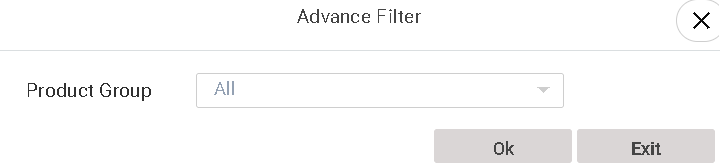
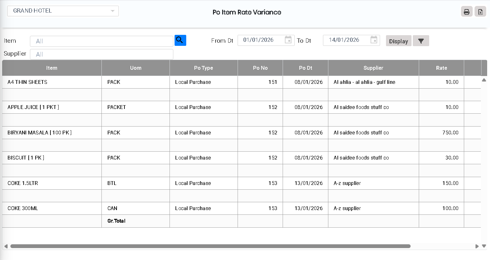

# PO Item Rate Variance

The **PO Item Rate Variance** is used to identify the difference between the rate (price) of an item in a Purchase Order (PO) and the agreed, standard, or expected rate.

## **Steps to View PO Item Rate Variance**

Step 1: Navigate to the **Purchase** main menu from the dashboard.

1. Click on **Analysis**.
2. From the Analysis menu, select **PO Item Rate Variance**.

* After clicking **PO Item Rate Variance**, the report screen will open.

<figure><figcaption></figcaption></figure>

Step 2: Click on the **Item Search** icon.

1. Search and select the required item for which you want to view the rate variance.

<figure><figcaption></figcaption></figure>

Step 3: Click on the **Advanced Filter** option available on the screen.

* Use filters to refine your report results.

<figure><figcaption></figcaption></figure>

Step 4: Click on the **Display** button.

* The system will generate and display the **PO Item Rate Variance** report based on the selected criteria.

<figure><figcaption></figcaption></figure>

Step 5: Click on the **Excel** button.

* The report will be downloaded in **Excel format** for further analysis, sharing, and record keeping.
